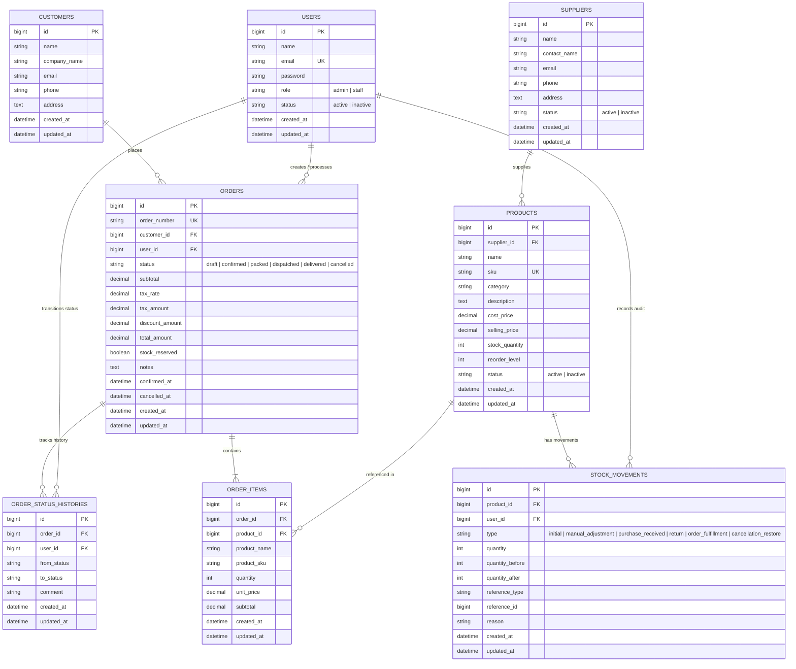

# Database Schema & API Documentation

This document provides the complete database architecture, entity-relationship diagrams, and API reference for the **NexTech Inventory & Order Management System**.

---

## 1. Database Architecture & Migrations

The database is built on MySQL using Laravel Eloquent ORM. All migrations are strictly ordered and enforce referential integrity, indexes, and constraints.

### Migrations Inventory

| Migration File | Primary Table | Purpose & Key Constraints |
|---|---|---|
| `2026_10_31_120101_create_users_table.php` | `users` | User accounts with `role` (`admin`, `staff`), `status` (`active`, `inactive`), unique `email`. |
| `2026_10_31_120102_create_suppliers_table.php` | `suppliers` | Wholesale distributor profiles with contact person, phone, and address. |
| `2026_10_31_120103_create_products_table.php` | `products` | Tech accessories catalog with unique `sku`, `supplier_id` (FK), `cost_price`, `selling_price`, `reorder_level`. |
| `2026_10_31_120104_create_orders_table.php` | `orders` | Sales orders with unique `order_number`, `customer_id` (FK), `user_id` (FK), financial totals, `status`. |
| `2026_10_31_120105_create_order_items_table.php` | `order_items` | Order line items with snapshot pricing (`product_name`, `product_sku`, `unit_price`, `quantity`, `subtotal`). |
| `2026_10_31_120106_create_stock_movements_table.php` | `stock_movements` | Immutable audit ledger tracking every stock delta (`quantity_before`, `quantity_after`, `type`, `reason`). |
| `2026_10_31_120107_create_customers_table.php` | `customers` | Client accounts (shops, corporate buyers) with contact info and order history. |
| `2026_10_31_120108_create_order_status_histories_table.php` | `order_status_histories` | State machine transition audit log with actor ID, from/to status, and comments. |
| `2026_10_31_120109_create_personal_access_tokens_table.php` | `personal_access_tokens` | Laravel Sanctum Bearer token storage. |

---

## 2. Entity-Relationship Diagram (ERD)



---

## 3. API Specification & Endpoint Examples

All API requests accept `Accept: application/json` and authenticated routes require `Authorization: Bearer <token>`.

### Authentication Endpoints

#### 1. User Login
- **Endpoint**: `POST /api/login`
- **Rate Limit**: 30 requests/minute per IP
- **Request Body**:
```json
{
  "email": "admin@nextech.pk",
  "password": "password123"
}
```
- **Response (200 OK)**:
```json
{
  "message": "Login successful",
  "token": "1|qX89yZ...plainTextToken",
  "user": {
    "id": 1,
    "name": "Muhammad Ali",
    "email": "admin@nextech.pk",
    "role": "admin",
    "status": "active"
  }
}
```

#### 2. Get Current Authenticated Profile
- **Endpoint**: `GET /api/me`
- **Response (200 OK)**:
```json
{
  "user": {
    "id": 1,
    "name": "Muhammad Ali",
    "email": "admin@nextech.pk",
    "role": "admin",
    "status": "active"
  }
}
```

---

### Dashboard Endpoints

#### 1. Aggregated Operational Metrics
- **Endpoint**: `GET /api/dashboard/stats`
- **Response (200 OK)**:
```json
{
  "metrics": {
    "total_revenue": "48000.00",
    "inventory_cost_value": "115200.00",
    "inventory_retail_value": "172500.00",
    "pending_orders": 2,
    "low_stock_count": 3,
    "total_products": 6,
    "total_units": 85
  },
  "low_stock_items": [
    {
      "id": 3,
      "name": "Logitech M185 Wireless Mouse",
      "sku": "LOGI-M185-WL",
      "stock_quantity": 4,
      "reorder_level": 8
    }
  ],
  "recent_orders": [
    {
      "id": 1,
      "order_number": "ORD-20261106-0001",
      "customer": { "id": 1, "name": "Bilal Computers" },
      "status": "confirmed",
      "total_amount": "51800.00",
      "created_at": "2026-11-06T15:59:18+05:00"
    }
  ]
}
```

---

### Products Endpoints

#### 1. List Products (Paginated & Filterable)
- **Endpoint**: `GET /api/products?page=1&search=Logitech&low_stock=true`
- **Response (200 OK)**:
```json
{
  "current_page": 1,
  "data": [
    {
      "id": 3,
      "name": "Logitech M185 Wireless Mouse",
      "sku": "LOGI-M185-WL",
      "category": "Mice & Keyboards",
      "cost_price": "1450.00",
      "selling_price": "2100.00",
      "stock_quantity": 4,
      "reorder_level": 8,
      "status": "active",
      "supplier": {
        "id": 1,
        "name": "PakTech Distribution"
      }
    }
  ],
  "total": 1,
  "last_page": 1
}
```

#### 2. Create Product
- **Endpoint**: `POST /api/products`
- **Request Body**:
```json
{
  "name": "Anker 65W GaN Fast Charger",
  "sku": "ANK-GAN-65W",
  "category": "Chargers & Power",
  "supplier_id": 1,
  "cost_price": 3200.00,
  "selling_price": 4500.00,
  "initial_stock": 25,
  "reorder_level": 5,
  "status": "active"
}
```
- **Response (201 Created)**:
```json
{
  "message": "Product created successfully",
  "product": {
    "id": 7,
    "name": "Anker 65W GaN Fast Charger",
    "sku": "ANK-GAN-65W",
    "stock_quantity": 25,
    "cost_price": "3200.00",
    "selling_price": "4500.00"
  }
}
```

---

### Orders & Workflow Endpoints

#### 1. Create Sales Order (With Snapshot Pricing & Auto-Stock Reservation)
- **Endpoint**: `POST /api/orders`
- **Request Body**:
```json
{
  "customer_id": 1,
  "status": "confirmed",
  "tax_rate": 5.0,
  "discount_amount": 500.00,
  "notes": "Deliver to Hafeez Centre shop counter",
  "items": [
    { "product_id": 3, "quantity": 2 },
    { "product_id": 7, "quantity": 1 }
  ]
}
```
- **Response (201 Created)**:
```json
{
  "message": "Order created successfully",
  "order": {
    "id": 4,
    "order_number": "ORD-20261106-0002",
    "status": "confirmed",
    "subtotal": "8700.00",
    "tax_amount": "435.00",
    "discount_amount": "500.00",
    "total_amount": "8635.00",
    "stock_reserved": true,
    "items": [
      {
        "product_id": 3,
        "product_name": "Logitech M185 Wireless Mouse",
        "product_sku": "LOGI-M185-WL",
        "quantity": 2,
        "unit_price": "2100.00",
        "subtotal": "4200.00"
      }
    ]
  }
}
```

#### 2. Advance Order Status
- **Endpoint**: `PATCH /api/orders/{id}/status`
- **Request Body**:
```json
{
  "status": "packed",
  "comment": "Packed in shipping carton #12"
}
```
- **Response (200 OK)**:
```json
{
  "message": "Order status updated to packed",
  "order": {
    "id": 4,
    "status": "packed"
  }
}
```

#### 3. Cancel Order (Automatic Stock Restock)
- **Endpoint**: `POST /api/orders/{id}/cancel`
- **Request Body**:
```json
{
  "reason": "Customer changed mind before dispatch"
}
```
- **Response (200 OK)**:
```json
{
  "message": "Order cancelled successfully and reserved inventory was restored",
  "order": {
    "id": 4,
    "status": "cancelled",
    "stock_reserved": false
  }
}
```

---

### Stock Movements Endpoints

#### 1. Adjust Stock (Manual / Return / Purchase)
- **Endpoint**: `POST /api/stock-movements`
- **Request Body**:
```json
{
  "product_id": 3,
  "type": "purchase_received",
  "quantity": 20,
  "reason": "Hafeez Centre shipment batch #8"
}
```
- **Response (201 Created)**:
```json
{
  "message": "Stock adjusted successfully",
  "movement": {
    "id": 11,
    "product_id": 3,
    "type": "purchase_received",
    "quantity": 20,
    "quantity_before": 2,
    "quantity_after": 22,
    "reason": "Hafeez Centre shipment batch #8"
  }
}
```

---

### Reports & Export Endpoints

#### 1. Low Stock Restock Ledger
- **Endpoint**: `GET /api/reports/low-stock`
- **Response (200 OK)**:
```json
{
  "count": 2,
  "total_deficit": 9,
  "total_valuation": "15450.00",
  "items": [
    {
      "id": 3,
      "name": "Logitech M185 Wireless Mouse",
      "sku": "LOGI-M185-WL",
      "stock_quantity": 4,
      "reorder_level": 8,
      "deficit": 4,
      "cost_price": "1450.00",
      "stock_value": 5800.00
    }
  ]
}
```

#### 2. Streaming CSV Exports (UTF-8 BOM Excel Compatible)
- `GET /api/reports/export/low-stock` → Downloads `low_stock_report_YYYY-MM-DD.csv`
- `GET /api/reports/export/orders?date_from=...` → Downloads `orders_export_YYYY-MM-DD.csv`
- `GET /api/reports/export/stock-movements` → Downloads `stock_movements_YYYY-MM-DD.csv`

